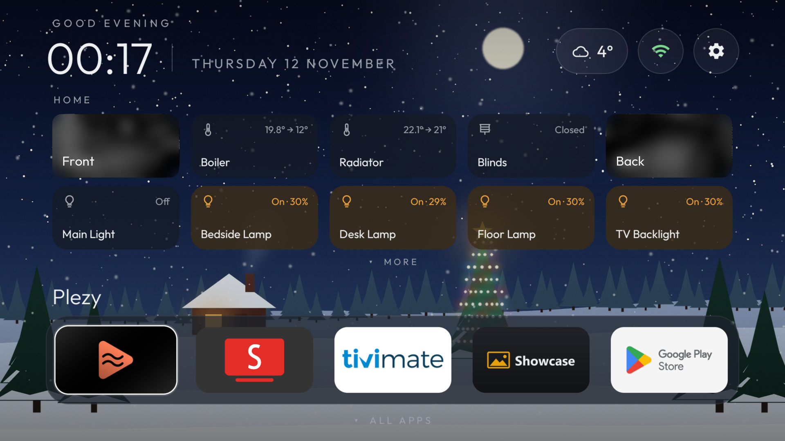
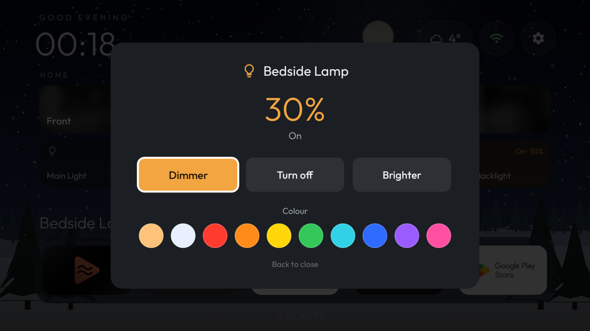
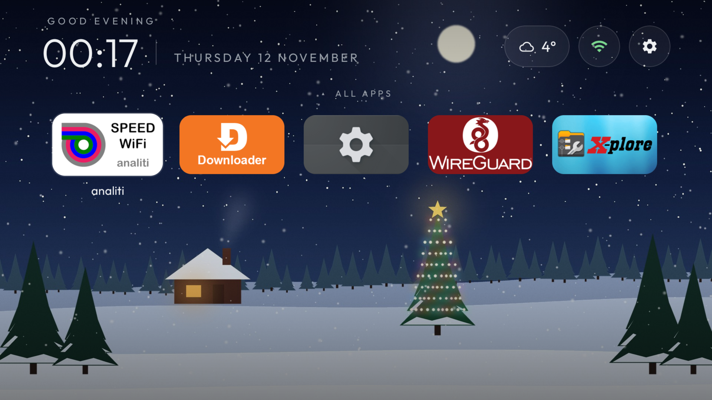
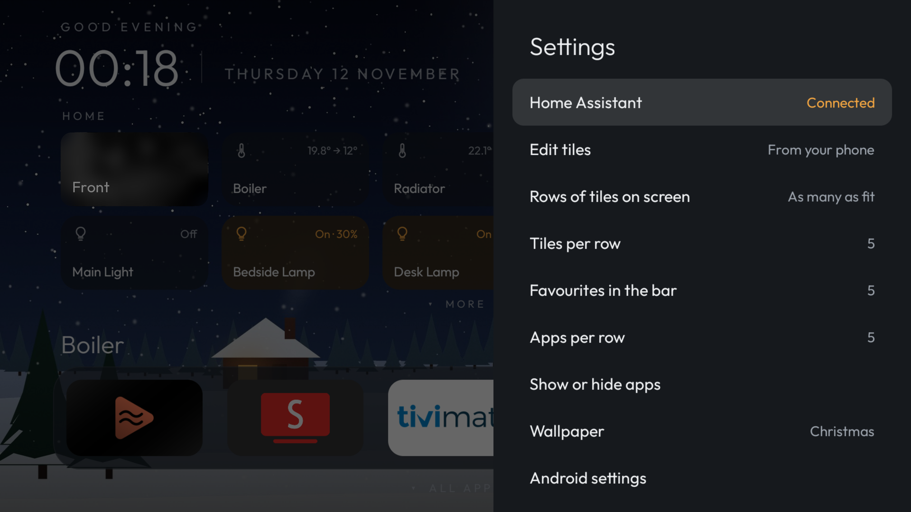

<div align="center">

# Hearth

**A calm, remote-friendly home screen for Android TV, with live Home Assistant tiles.**

Built on (and for) the NVIDIA SHIELD. Your lights, heating, blinds and cameras sit right on the home screen, one press away.

[Download the latest APK](../../releases/latest) · [Set up Home Assistant](#set-up-home-assistant) · [Build it yourself](#build)



</div>

## What you get

- **Home Assistant tiles that update instantly** over the WebSocket API. Press OK to toggle lights, plugs, fans and blinds, run scenes and scripts, or open a camera full screen.
- **Hold OK for more**: brightness and colour on lights, the heating set-point, blind position and volume.
- **A favourites bar** along the bottom. Press down for every other app.
- **One gliding highlight** that follows the remote smoothly, with no jumping or flashing between sections.
- **A tidy header** with greeting, clock, date, weather (from your Home Assistant weather entity) and a green/red network light.
- **Wallpapers**: five built-in scenes, solid colours, or a **Bing Photo of the day** slideshow.
- **Set up from your phone**: scan a QR code and pick your tiles on a small page served by the TV. No typing tokens with a remote.

<table>
  <tr>
    <td width="50%"></td>
    <td width="50%"></td>
  </tr>
  <tr>
    <td align="center"><sub><b>Hold OK on a light</b> to dim it or change its colour</sub></td>
    <td align="center"><sub><b>Press down</b> from the favourites for all your apps</sub></td>
  </tr>
  <tr>
    <td width="50%"></td>
    <td width="50%"></td>
  </tr>
  <tr>
    <td align="center"><sub><b>Settings</b>: rows, tiles per row, favourites, apps per row</sub></td>
    <td align="center"><sub><b>Built-in wallpapers</b>, plus a night sky, solid colours and Bing</sub></td>
  </tr>
</table>

## Using it

| Remote | What happens |
| --- | --- |
| **OK** on a tile | Toggle it (lights, plugs, fans, blinds), run it (scenes, scripts) or open it (cameras) |
| **Hold OK** on a tile | Brightness, colour, set-point, blind or volume controls |
| **Hold OK** on an app | Add to or remove from favourites, move it, or hide it |
| **Down** from the favourites | All apps |
| **Up** from the favourites | The row of tiles just above |
| **Back** | Closes whatever is open, then returns to the favourites bar |
| **Home** | Back to Hearth, on your first favourite |

Got more tiles than fit? Hearth shows as many whole rows as there is room for (or the number you choose in Settings) and slides the next row in when you move down, with a **MORE** hint so you know there's more.

## Install

1. Download `Hearth-x.y.z.apk` from [Releases](../../releases) and sideload it, for example with the **Downloader** app or `adb install`.
2. Make it your home screen:

   ```bash
   adb shell cmd package set-home-activity app.hearth.tv/.ui.HomeActivity
   ```

   Without this, pressing Home asks which home app to use each time.

To go back to your previous launcher, run the same command with that launcher's activity, or uninstall Hearth.

## Set up Home Assistant

1. In Home Assistant, open your profile, then **Security** → **Long-lived access tokens** → **Create token**.
2. On the TV, open **Settings → Home Assistant** and scan the QR code with your phone.
3. Enter your Home Assistant address *as the TV can reach it* (for example `http://192.168.1.20:8123`), paste the token and tap **Connect**.
4. Pick your tiles, rename them if you like, put them in order, choose a weather entity and tap **Save to TV**.

The same page has **Download settings** and **Restore from file**, so you can back up your tiles, names, favourites, layout and wallpaper, and restore them after a reinstall. Backups never include the token.

### Privacy and security

- The setup page is only reachable on your local network, and every request needs the 6-digit code shown on the TV.
- The token stays on the TV (`allowBackup=false`). The page never sends it back out.
- Hearth only talks to your Home Assistant, plus Bing if you choose the Photo of the day wallpaper. There is no analytics or tracking.

## Build

You need the Android SDK (API 37) and JDK 17 or newer (Android Studio's bundled JBR works).

```bash
./gradlew assembleDebug
```

Release builds are signed with a key kept **outside** the repo. Put `keystore.properties` (with `storeFile`, `storePassword`, `keyAlias` and `keyPassword`) and the keystore in `~/.hearth-signing/`, or point `HEARTH_SIGNING_DIR` at them, then run:

```bash
./gradlew assembleRelease
```

Without a key, the release APK is unsigned.

Hearth is written in Kotlin with Jetpack Compose for TV, and uses OkHttp for Home Assistant and ZXing for the QR code.

## Licence

MIT, see [LICENSE](LICENSE). The Outfit font is under the SIL Open Font License ([FONT-LICENSE.txt](FONT-LICENSE.txt)). See [THIRD-PARTY-NOTICES.md](THIRD-PARTY-NOTICES.md) for other components.
